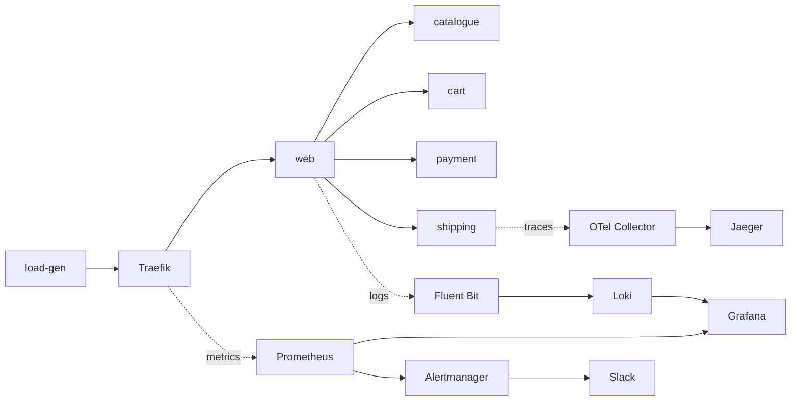

# Capstone 2: Keep It Running (Stan's Robot Shop)

This is my Capstone 2 project. I took Robot Shop, a small online shop made of about 12 services, and added monitoring, logs, tracing and alerts. Now I can see when something breaks and find out why.

Original app: [instana/robot-shop](https://github.com/instana/robot-shop)

## Architecture



## What I added or changed

```
K8s/helm/                          the provided chart (Instana settings removed, plus my fixes)
K8s/load-deployment.yaml           load-gen: goes through Traefik, 5 clients, ERROR=0
K8s/robot-shop-ingress.yaml        sends shop traffic through Traefik
monitoring/                        all monitoring config (values files, dashboard, alert)
docs/slo.md                        SLO and error budget policy
docs/runbook.md                    what to do when the alert fires
```

## How to run it

On a kind cluster:

```bash
kind create cluster --name robot-shop
kubectl create namespace robot-shop
helm install robot-shop K8s/helm -n robot-shop
kubectl apply -n robot-shop -f K8s/load-deployment.yaml
```

Monitoring (create the two secrets first, they are not in Git):

```bash
kubectl create namespace monitoring
kubectl create secret generic grafana-admin -n monitoring --from-literal=admin-user=admin --from-literal=admin-password=<password>
kubectl create secret generic alertmanager-slack -n monitoring --from-literal=url=<slack-webhook-url>
helm install monitoring prometheus-community/kube-prometheus-stack -n monitoring -f monitoring/kube-prometheus-stack-values.yaml --version 92.11.0
helm install traefik traefik/traefik -n traefik --create-namespace -f monitoring/traefik-values.yaml --version 42.1.3
kubectl apply -f K8s/robot-shop-ingress.yaml
kubectl apply -f monitoring/dashboards/robot-shop-dashboard.yaml
kubectl apply -f monitoring/alerts/robot-shop-slo.yaml
```

Logs and tracing:

```bash
helm install loki grafana/loki -n logging --create-namespace -f monitoring/loki-values.yaml --version 7.5.0
helm install fluent-bit fluent/fluent-bit -n logging -f monitoring/fluent-bit-values.yaml --version 0.58.3
kubectl apply -f monitoring/jaeger.yaml
helm install otel-collector open-telemetry/opentelemetry-collector -n tracing -f monitoring/otel-collector-values.yaml --version 0.177.0
```

## The six steps

1. **Deploy and watch.** All pods healthy, load-gen sending steady traffic.
2. **Metrics.** Traefik counts every request. My Grafana dashboard shows requests, errors and p95 latency per route.
3. **Logs.** Fluent Bit sends the shop's logs to Loki. Search by service and level, for example `{service="payment"} | detected_level="error"`.
4. **Trace.** The OpenTelemetry Java agent on shipping sends traces through the Collector to Jaeger. No code changes.
5. **SLO.** 99% of requests should work over 30 days. If more than 5% fail for 2 minutes, Slack gets an alert with a link to the runbook.
6. **Drill.** Done with the instructor. Postmortem in `docs/`.

## Problems I hit and fixed

- **mysql and rabbitmq** were OOMKilled at startup. They are old versions that use too much memory when the open-files limit is huge. I set `ulimit -n 65536` before they start.
- **shipping** (Java) was OOMKilled. I raised its memory limit from 1000Mi to 1500Mi.
- **shipping** kept failing its health check because it only had 0.2 of a CPU. I gave it 1 core.
- **shipping** froze while Java cleaned up memory under heavy load. I lowered load-gen to 5 clients. The proper fix is to return city lists in pages.
- **load-gen** was OOMKilled. I raised its memory to 512Mi.
- The trace for `/cities/{code}` showed that about 70% of the time is the MySQL query.

## Secrets

The Grafana password and the Slack webhook URL are Kubernetes Secrets that I create by hand. They are not in Git.
